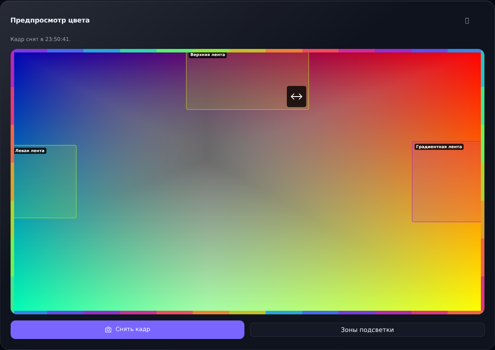
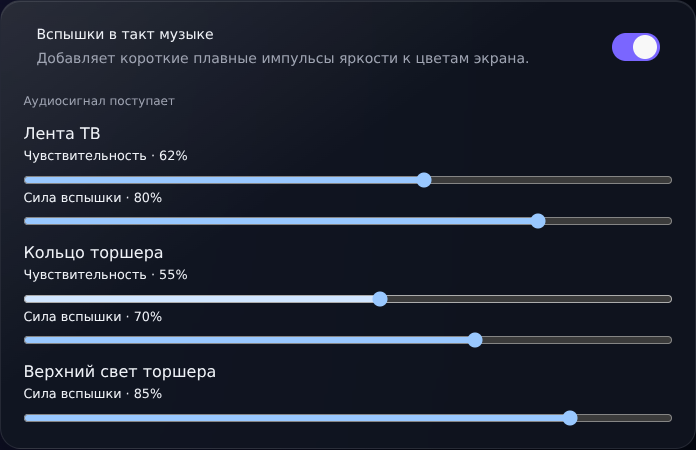
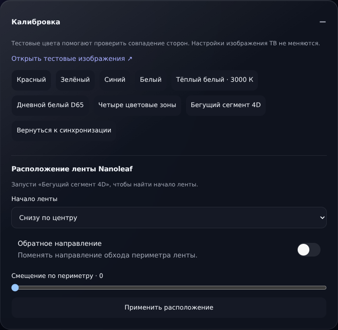

# LG Hue Sync Custom

Подсветка в цвет экрана для LG webOS с русской панелью управления. Поддерживает **Philips Hue Entertainment**, **Nanoleaf 4D** и торшер **Govee C60B0** через мост ESP32-S3.

[](https://github.com/kartemoon/lg-hue-sync-custom/releases/latest)
[](docs/install-ipk.md)
[](LICENSE)

[Установка и обновление](docs/install-ipk.md) · [Калибровка Nanoleaf](CUSTOM_CHANGES.md#калибровка-nanoleaf-4d) · [Список доработок](CUSTOM_CHANGES.md)



## Что умеет

- **Захват изображения.** HDMI, медиаплеер LG, YouTube, Кинопоиск, Lampa и Иви. Встроенные приложения можно включать отдельно. Для HDMI доступен режим до 60 FPS.
- **Nanoleaf 4D и Hue.** Предпросмотр зон, компенсация чёрных полос, настройка положения ленты и фоновые сцены, когда захват на паузе.
- **Музыкальная синхронизация.** Плавные импульсы для ленты и торшера. Цвет и параметры эффекта идут по локальной сети на ESP32-S3, который управляет Govee C60B0 по BLE. Для торшера нужна отдельная прошивка моста.
- **Управление с телефона или ПК.** Настройки цвета и отклика, диагностика и перезапуск службы из браузера.

## Русский интерфейс

| Музыкальный режим | Калибровка ленты |
| :---: | :---: |
|  |  |

На скриншотах показан локальный деморежим с тестовыми данными.

## Быстрый старт

1. Скачайте IPK и `SHA256SUMS` со [страницы релиза](https://github.com/kartemoon/lg-hue-sync-custom/releases/latest).
2. Установите пакет на LG webOS с root-доступом и активируйте службу через SSH. Команды есть в [инструкции по установке](docs/install-ipk.md).
3. Откройте `http://<IP-телевизора>:8088/` в домашней сети и подключите подсветку.

Совместимость захвата зависит от модели, прошивки и контента. Приложение не обходит DRM.

Проект основан на [adeze/lg-hue-sync v1.1.0](https://github.com/adeze/lg-hue-sync/tree/v1.1.0). Лицензия MIT сохранена.

<details>
<summary>Техническая документация, сборка и обслуживание</summary>

## Limits and safety

- Root access is required. Rooting can void warranties or render a TV unusable; confirm model and firmware compatibility first.
- Capture supports HDMI, the LG media player and selected built-in apps. Actual frame availability depends on the TV and content. The capture policy does not bypass DRM.
- Hue decides how physical gradient segments are grouped into Entertainment channels. This project streams the selected area's returned channels; it does not fabricate more.
- LG private capture APIs and community root methods are unsupported by LG and may change with firmware.

Check [cani.rootmy.tv](https://cani.rootmy.tv/) and [webOS Brew](https://github.com/webosbrew) before changing a TV.

## Requirements

- Development Mac with Rust/rustup, [cargo-nextest](https://nexte.st/docs/installation/pre-built-binaries/), webOS Brew native SDK, `make`, SSH, and `uv`. Docker is needed for one-time sysroot setup or the explicit fallback.
- Rooted webOS TV with root SSH and compatible capture libraries.
- Hue Bridge v2 and/or Nanoleaf 4D on the same LAN.

## Validate and build

```bash
cargo fmt --all -- --check
cargo nextest run --locked
cargo clippy --bin lg-hue-sync -- -D warnings
make build
file target/armv7-unknown-linux-gnueabi/release/lg-hue-sync
```

The default target build uses the Mac webOS SDK compiler with a Buster sysroot to stay within the LG C1/webOS 6 glibc ceiling. It produces an ARM Linux binary; ordinary host Cargo builds produce Mac binaries for tests.

Run `make native-setup` once using the installed [webosbrew/native-toolchain](https://github.com/webosbrew/native-toolchain) and cached builder, then `make build` without Docker. `make build-docker` remains the explicit fallback and Linux CI path. Rust Ares powers `make package-app` and explicit-device launcher management. See [docs/operations.md](docs/operations.md) for setup, ABI gates and deployment boundaries.

Apple Shortcuts can apply a dashboard preset over the trusted LAN with a `POST` request to `http://<tv-ip>:8088/api/presets/<name>`; see [docs/operations.md](docs/operations.md#apple-shortcuts-and-presets). Preset changes are live until saved. The generated OpenAPI description for all HTTP API routes is available at `http://<tv-ip>:8088/openapi.json`; see [API discovery](docs/operations.md#http-api-description).

## Install and update

The dashboard includes a web app manifest and QSync icons. In **Devices → QSync app**, find installation guidance or an install button when supported. On iPhone/iPad, use Safari **Share → Add to Home Screen**; on Mac, **File → Add to Dock**. Automatic PWA install prompts require HTTPS (or localhost during development); the TV's plain HTTP LAN address may only support manual installation or a shortcut, depending on the browser. The app requires a reachable TV and does not cache controls or frames offline. No service worker or additional TV process is installed.

First installation, after root SSH already works:

```bash
./scripts/deploy.sh <tv-ip>
```

Existing installation, preserving paired credentials and layout:

```bash
make deploy-bin TV_IP=<tv-ip>
```

Then open `http://<tv-ip>:8088/`, pair devices, choose a Hue Entertainment Area, and save settings. Never copy a populated `config.json` between users or commit it.

Build, rollback, uninstall, and verification details: [docs/operations.md](docs/operations.md).

## Development commands

```bash
cargo run -- pair --bridge <bridge-ip> --output config.json
cargo run -- pair-nanoleaf --ip <controller-ip> --config config.json
cargo run -- sync-hue --config config.json
cargo run -- test-pattern --config config.json
cargo run -- test-nanoleaf --config config.json
cargo run -- run --config config.json
```

Pairing and patterns affect physical devices. Use them only when the owner expects light output.

`uv run scripts/pair_hue.py --bridge-ip <bridge-ip> --output-config config.json`
remains a deprecated compatibility wrapper for Rust HTTPS pairing. It builds for
the Rust compiler's host target, preserves the existing argument names, and no
longer accepts `--tv-ip` or configures Hyperion directly.

For screen-to-light mapping checks, display the [4K calibration images or selectable browser patches](calibration-patterns/README.md) through the viewing HDMI source. Unlike the dashboard's direct light tests, these exercise capture and video-derived sampling.

## Configuration

Start from [config.example.json](config.example.json), or pair through the dashboard. Runtime configuration contains secrets and stays untracked. On the TV:

```text
/var/home/root/lg-hue-sync/config.json
```

Hue HTTPS validates the two official Hue root CAs and the saved Bridge ID. Existing certificate pins bootstrap that identity only on an exact match; subsequent signed certificate renewal retains the identity check. Pairing never falls back to HTTP. Status endpoints never return Hue or Nanoleaf secrets.

## Project layout

```text
src/                 daemon, capture, colour, Hue, Nanoleaf, dashboard
webos-app/           optional launcher/dashboard package
scripts/             build, provisioning, deployment, maintenance
docs/                architecture, operations, release runbooks
```

Useful implementation references:

- [webosbrew/native-toolchain](https://github.com/webosbrew/native-toolchain) — webOS sysroot/toolchain reference.
- [openlgtv/buildroot-nc4](https://github.com/openlgtv/buildroot-nc4) — Buildroot source behind the community SDK, not a drop-in Rust linker fix.
- [webosbrew/webos-userland](https://github.com/webosbrew/webos-userland/tree/main) and its [API reference](https://www.webosbrew.org/webos-userland/index.html) — community stub headers and libraries for native LG userland APIs; validate symbols and behavior on the target firmware.
- [webosbrew/hyperhdr-webos-loader](https://github.com/webosbrew/hyperhdr-webos-loader) — app/service packaging and lifecycle reference.
- [webosbrew/ares-cli-rs](https://github.com/webosbrew/ares-cli-rs) — packaging, install, shell, and transfer tooling.
- [HyperHDR](https://github.com/awawa-dev/HyperHDR) — reference for colour precision, temporal smoothing, source calibration, and stage metrics; adapt only after measuring this TV's pipeline.
- [webosbrew/apps-repo](https://github.com/webosbrew/apps-repo) — Homebrew Channel submission format.

</details>

## Contributing

This is currently a single-maintainer project. Changes go directly to `main`; no pull request is required unless the maintainer explicitly asks for one. Run the validation commands before pushing.

## License

[MIT](LICENSE)
